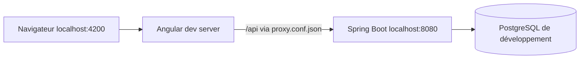
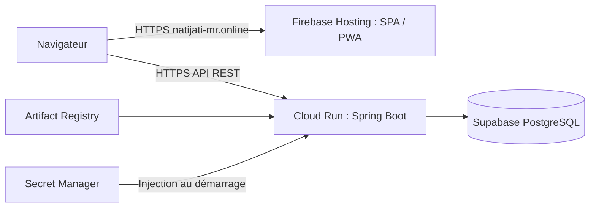

# Natijati MR Frontend

Portail Angular de consultation des résultats des examens nationaux mauritaniens :
BAC, BEPC et C1AS. L’utilisateur choisit un examen, une année et une session pour
consulter un résultat, rechercher des candidats ou explorer les indicateurs publics.

Projet indépendant, sans affiliation revendiquée au ministère.
Site public : [natijati-mr.online](https://natijati-mr.online).
API et document d’architecture principal : dépôt compagnon **natijati-mr-api**,
fichier `docs/ARCHITECTURE.md`. Les dépôts restent indépendants ; aucun lien relatif
traversant leurs racines n’est nécessaire.

## Fonctionnalités

- Résultats BAC/BEPC par numéro de candidat ; C1AS par numéro de dossier.
- Choix année/session `NORMAL` ou `COMPLEMENTARY`, archives et recherche paginée.
- Statistiques, liste et détail des établissements.
- Français/arabe, RTL, pagination localisée et polices locales.
- Interface responsive, navigation mobile Material, lien d’évitement, focus visible,
  erreurs accessibles et messages de chargement.
- PWA : shell statique hors ligne et mise à jour contrôlée.
- Métadonnées par page, sitemap des routes stables et exclusion d’indexation des
  résultats/recherches. Aucune donnée nominative dans les titres ou métadonnées.

La disponibilité des résultats dépend des sessions réellement importées et publiées
par l’API ; la présence d’un parcours BEPC/C1AS ne signifie pas que toutes les années
sont disponibles.

## Stack et architecture

| Technologie | Rôle |
| --- | --- |
| Angular 20, composants standalone | Pages et routage différé |
| Signals et RxJS | État local réactif, requêtes et changements de route |
| Angular Material / CDK | Formulaires, menus, pagination et direction RTL |
| Tailwind CSS 4, Sass | Utilitaires CSS via PostCSS ; thème Material en SCSS séparé |
| Angular Service Worker | Versionnement et cache statique |
| Fontsource | Inter, Tajawal et Material Symbols auto-hébergés |
| Jasmine/Karma, Node | Tests Angular et régressions métier/PWA |
| Firebase Hosting | Distribution statique HTTPS |

Les versions reproductibles sont dans [package-lock.json](package-lock.json),
les scripts dans [package.json](package.json).

```text
src/app/
├── core/
│   ├── models/       contrats TypeScript de l’API
│   └── services/     HTTP, i18n, métadonnées et pagination localisée
├── features/         home, result, exams, search, statistics, institutions, about
├── shared/components/
│   ├── header/       navigation desktop/mobile
│   └── pwa-status/   hors ligne et mise à jour
├── app.routes.ts
└── app.config.ts
```

Les services HTTP centralisent les URL et paramètres. Les pages portent leur état
local ; aucun store global supplémentaire n’est nécessaire actuellement.

## Lancement local

Prérequis : Node 22 compatible Angular 20 (22.23.2 utilisé lors des validations),
npm et l’API locale sur le port 8080. Chrome/Chromium est nécessaire aux tests Angular.

```sh
npm ci
npm start
```

Ouvrir `http://localhost:4200`. Le profil development utilise `/api`, redirigé vers
`http://localhost:8080` par [proxy.conf.json](proxy.conf.json).



Les URL sont configurées dans les fichiers
[development](src/environments/environment.development.ts) et
[production](src/environments/environment.ts). Ce sont des configurations publiques,
pas des emplacements pour des secrets. Le build de production appelle directement
l’API Cloud Run en HTTPS, sans passer par le proxy Angular.

## Routes

| Route | Page |
| --- | --- |
| `/` | Accueil et recherche par identifiant |
| `/exams` | Archives et sessions publiées |
| `/search` | Recherche multicritère |
| `/statistics` | Statistiques agrégées |
| `/institutions` | Établissements |
| `/institutions/:id` | Détail établissement |
| `/about` | Présentation et sources |
| `/result/:examType/:year/:candidateNumber` | Résultat individuel |

Le dernier segment historique `candidateNumber` transporte un **numéro de dossier**
pour C1AS ; le service HTTP construit alors l’endpoint `/c1as/{year}/dossier/{id}`.
Le paramètre `sessionType` conserve le choix de session entre les parcours.

## Français, arabe et accessibilité

[I18nService](src/app/core/services/i18n.service.ts) contient des dictionnaires
FR/AR typés et un Signal de langue persisté localement. Il met à jour `lang`, `dir`
et la police arabe. Ce système maison n’est pas le moteur Angular i18n, même si
le package `@angular/localize` existe pour l’outillage Angular.

La direction est transmise au CDK ; pagination et métadonnées suivent la langue.
Les chiffres ne sont pas transformés arbitrairement. Les adaptations incluent
navigation clavier, `aria-current`, annonces de statut et erreurs de formulaire.
Cela ne constitue pas une certification WCAG : une recette lecteur d’écran et
multi-navigateurs reste nécessaire.

## PWA et confidentialité

La configuration [ngsw-config.json](ngsw-config.json) conserve **`dataGroups: []`**.
Aucune réponse API n’est mise en cache par Angular Service Worker.

- Shell et scripts préchargés ; images et polices mises en cache à la demande.
- Résultats individuels et recherche nominative nécessitent Internet, sans fallback
  sur un ancien résultat en cache.
- [natijati-worker.js](public/natijati-worker.js) intercepte ces requêtes avec
  `cache: no-store` et supprime les anciens caches nominatifs reconnus lors de son activation.
- La protection de migration nécessite que le nouveau worker soit installé et actif.
- La notification de version prête propose un rechargement volontaire ; pas de
  boucle de rechargement automatique.

Le worker est actif en build production, pas sous `npm start`. Les chunks de route
restent différés pour Angular, mais le worker les précharge à l’installation pour
préserver le shell hors ligne. Ne pas confondre les deux mécanismes.

## Tests et build

```sh
npm test                  # Angular, surveillance des changements
npm run test:ci           # Angular, passage unique ChromeHeadless
npm run test:business     # Régressions métier avec Node
npm run test:coverage     # Couverture Angular dans coverage/
npm run build            # Production + service worker
npm run test:pwa          # Nécessite le build généré
npm audit --omit=dev
```

Voir [tests/README.md](tests/README.md) pour l’isolation HTTP, les harnesses Material
et les limites de couverture. Si nécessaire, définir `CHROME_BIN` vers Chrome/Chromium.
Les tests n’utilisent ni résultats réels ni services cloud. Aucun Playwright/Cypress
installé ; les tests de composants ne sont pas des E2E de l’application déployée.

Le build est produit dans `dist/national-exams-frontend/browser`. Les polices sont
locales : une fois les dépendances installées, aucune récupération Google Fonts
n’est nécessaire pour compiler. Les icônes PWA ont les dimensions déclarées.

## Production et SEO



[firebase.json](firebase.json) décrit les réécritures SPA, le cache des fichiers
hashés, la revalidation du shell/workers et les en-têtes `X-Robots-Tag` des pages
sensibles. Ces règles locales ne prouvent pas qu’une version donnée a été déployée.
Le déploiement est préparé dans un workflow manuel, distinct de la CI.
Voir [CI/CD et prérequis WIF](docs/CI_CD.md) avant toute activation.

Les titres sont mis à jour via les services Angular `Title`/`Meta`. Les pages
résultat/recherche reçoivent `noindex` ; le sitemap ne contient que des routes
stables non nominatives. Le partage sans JavaScript reste générique. `noindex`
n’est pas un contrôle d’accès et n’empêche pas un utilisateur de consulter une URL.

Pas de SSR actuellement : la consultation dynamique et la confidentialité priment.
Un pré-rendu des pages éditoriales pourra être évalué si leur référencement devient
prioritaire, sans rendre indexables les résultats individuels.

## Sécurité et limites connues

L’API distingue public/admin et restreint CORS ; aucun identifiant admin ne doit être
embarqué dans Angular. L’audit npm de production affichait zéro alerte lors de la
validation du 15 octobre 2026 ; réexécuter la commande, ce n’est pas une garantie
permanente. Des alertes d’outillage de développement subsistent.

- Pas de E2E installés ni de score Lighthouse/certification d’accessibilité revendiqué.
- Certaines listes d’années des filtres restent explicites dans les composants.
- Libellés officiels reçus de l’API conservés ; leur traduction n’est pas exhaustive.
- Les pages statistiques utilisent un titre générique, sans reprendre leurs filtres.
- CI/CD préparée, configuration GitHub/WIF manuelle encore nécessaire.
- Pas de SSR ou nouvelle fonctionnalité admin dans ce dépôt.

## Captures d’écran

Aucune capture de l’interface n’est versionnée actuellement. À ajouter avec des
données synthétiques : accueil desktop, résultat desktop, mobile arabe et statistiques.
Les icônes/logo existants ne sont pas des captures applicatives. Ne jamais publier
une capture de résultat nominatif réel sans autorisation appropriée.

## Contribution et licence

Projet personnel : changements ciblés, tests pertinents et validation du build/PWA.
Ne pas versionner de secrets. Aucune licence du projet n’est définie actuellement ;
son choix appartient à l’auteur. Les licences des polices sont incluses dans le build.
